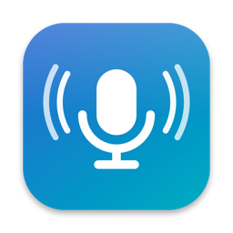
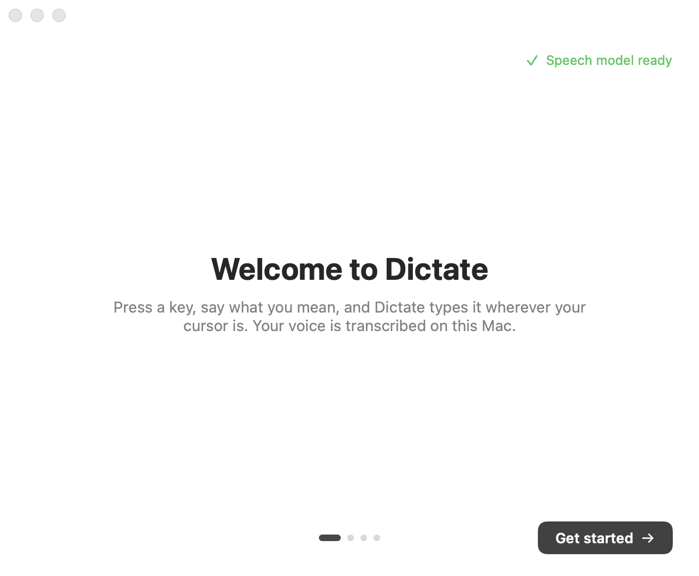
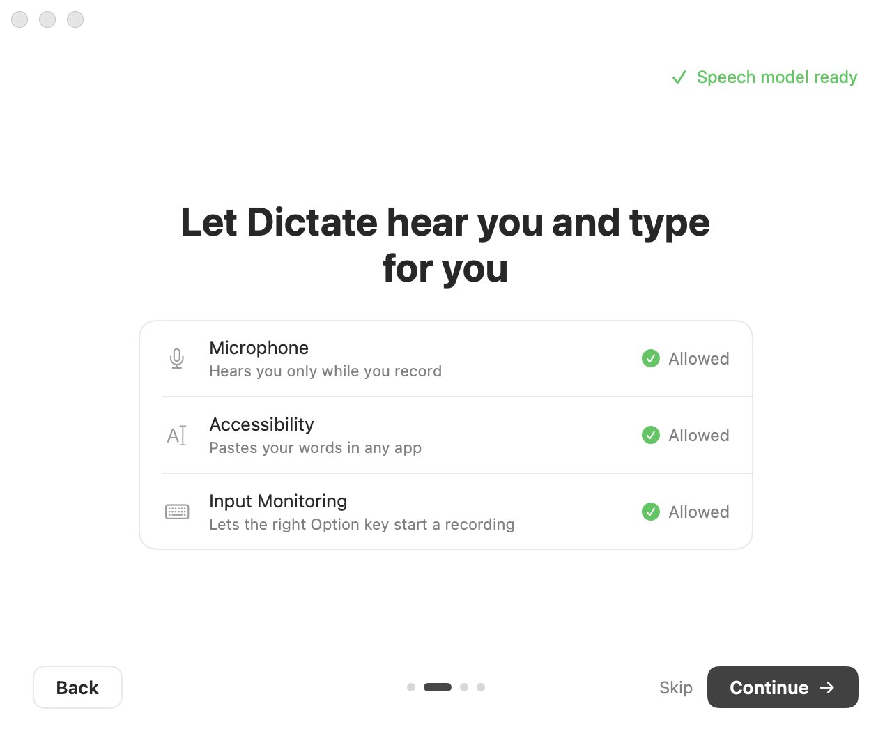
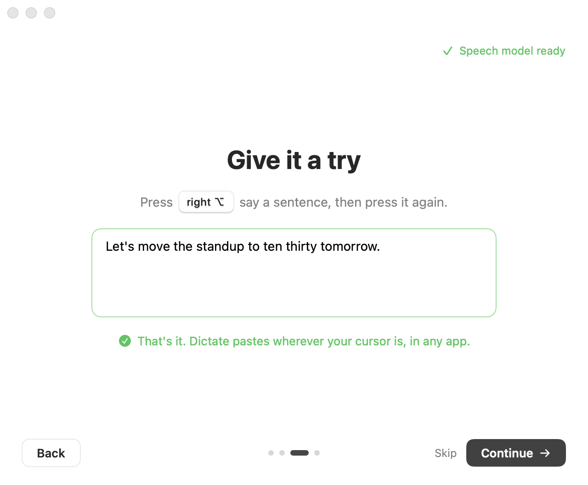
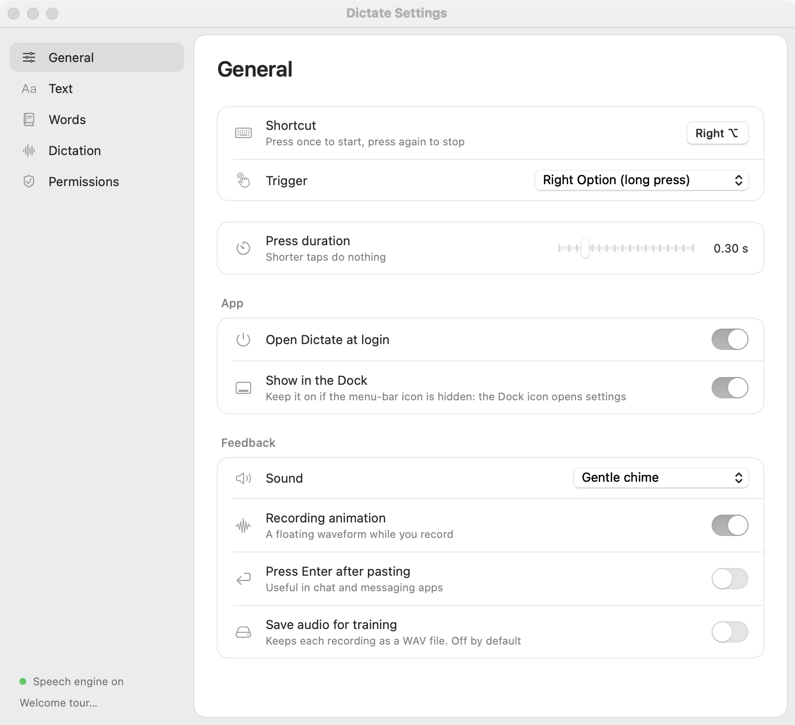
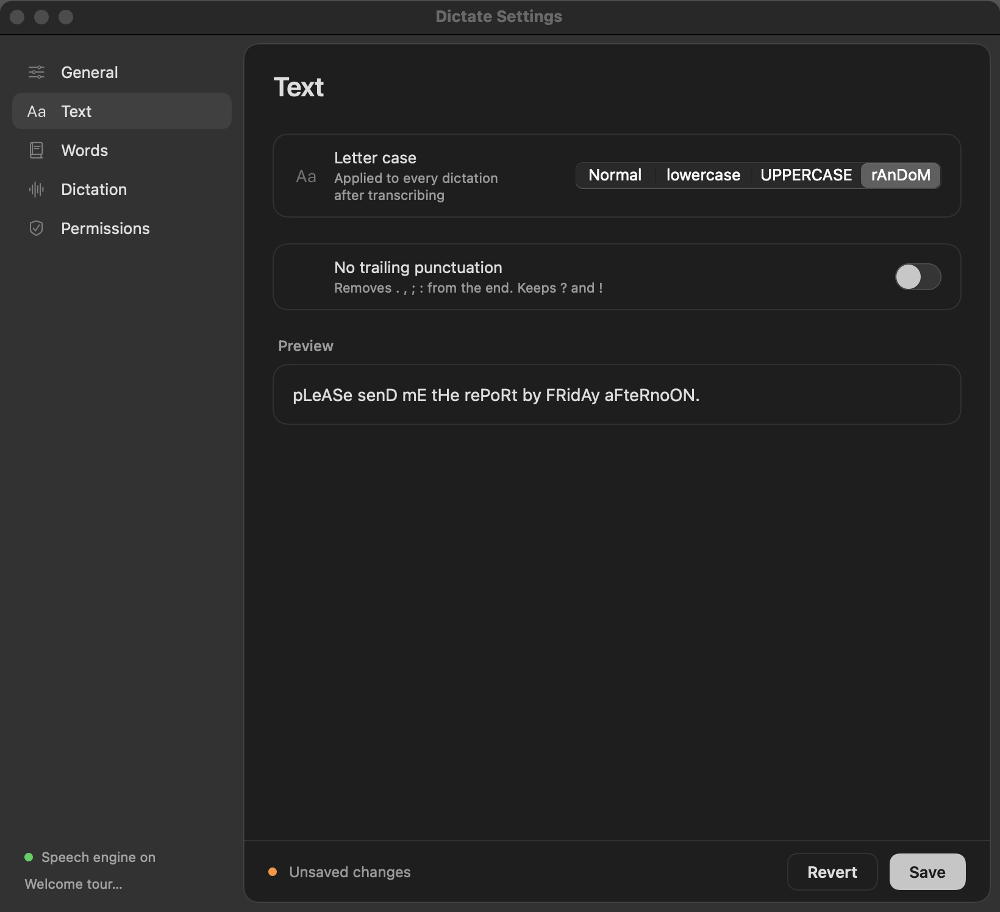
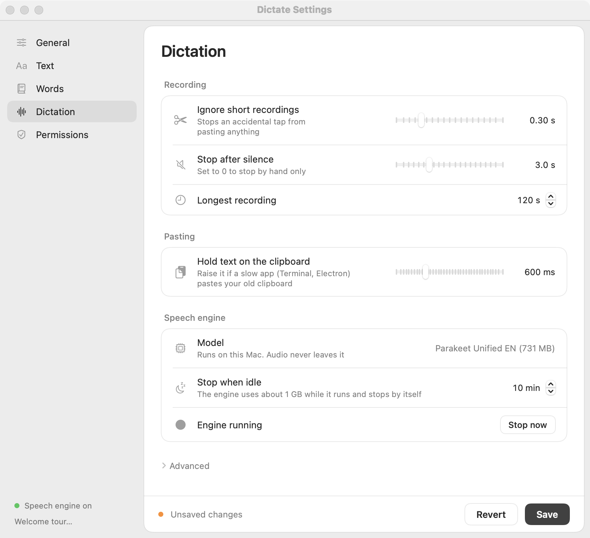

<div align="center">



# Dictate

**Talk, and the text lands wherever your cursor is.**
A macOS menu-bar dictation app. All transcription runs locally, so your audio never leaves your Mac.


</div>

## 🎬 See it in action

https://github.com/user-attachments/assets/3ec8319d-ad5d-459f-97f2-c1e4ac40beab

## 🖼️ Screenshots

<div align="center">

| Welcome | Permissions | Try it |
|---|---|---|
|  |  |  |

| General | Text (dark) | Dictation |
|---|---|---|
|  |  |  |

</div>

## ✨ Features

| | Feature | What it does |
|---|---|---|
| 🎙️ | **Toggle recording** | Press to start, press again to stop. No holding a key down. |
| 🌊 | **Floating waveform** | Nine animated bars that adapt to dark and light mode |
| 🧠 | **On-device speech model** | Parakeet Unified EN 0.6B, under 0.1 s per clip, audio never leaves the Mac |
| 🔠 | **Text style** | Normal, lowercase, UPPERCASE or random case, plus optional removal of the trailing period |
| 👋 | **Welcome tour** | First launch walks through permissions and a practice dictation |
| 🗣️ | **Voice commands** | Say "my email" and it inserts your email address |
| 🔁 | **Text replacements** | Word-level rules, e.g. "cloud code" → "Claude Code" |
| 🤫 | **Silence auto-stop** | Stops recording after a configurable pause |
| 📚 | **Correction learning** | Notices your edits after a paste and suggests replacements |
| 🔊 | **Sound packs** | 9 futuristic press and release sound packs with live preview |
| ↩️ | **Auto-press Enter** | Optional, for chat and messaging apps |
| ⎋ | **Escape to discard** | Throw away a recording mid-flight |
| 💾 | **Audio saving** | Opt-in, for future model training |

## 🔒 Privacy

- All audio processing happens on your Mac
- The only download is the speech model (731 MB, once, from Hugging Face). After that the app works offline
- The server listens on `127.0.0.1` only (the config validator rejects non-localhost URLs)
- Audio saving is opt-in and off by default
- No data is sent to any cloud service

## 📋 Requirements

- macOS 14+ (Sonoma or later)
- Xcode or the Xcode Command Line Tools (`xcode-select --install`)
- Python 3.10+ (macOS ships 3.9, so `brew install python@3.11` if needed)
- Parakeet: about 731 MB disk for the model and about 1 GB RAM while it runs (it stops after 10 idle minutes)

## 🚀 Quick start

### 1. Clone, set up and build

Clone anywhere you like, and keep the folder: the app runs its server from it.

```bash
git clone https://github.com/rajualankar2-stack/dictate-app.git
cd dictate-app
bash scripts/setup.sh       # creates .venv and downloads the Parakeet model (731 MB, once)
bash scripts/build_app.sh
open build/Dictate.app
```

The app starts the transcription server itself on the first key press. Nothing else needs to be installed: the speech engine (`transcribe-cpp`, Metal) runs inside the app's own Python.

### 2. Signing

`build_app.sh` signs with your Apple Development certificate if you have one. Without one it signs ad-hoc, which works, but macOS treats every rebuild as a new app, so you have to grant Accessibility again after each rebuild.

### 3. Grant permissions

On first launch a short welcome tour asks for these, one at a time, then lets you try a dictation. Reopen it any time from the menu bar icon (Welcome tour…). macOS asks for:

- **Microphone**, for recording
- **Accessibility**, for pasting text (System Settings → Privacy & Security → Accessibility)
- **Input Monitoring**, only if you use the right Option key as the shortcut

### 4. Configure

Open Settings from the menu bar icon:

| Page | Settings |
|---|---|
| **General** | Shortcut, launch at login, Dock icon, sounds, animation, auto-Enter, audio saving |
| **Text** | Letter case (normal, lowercase, UPPERCASE, random) and no trailing punctuation, with a live preview |
| **Words** | Vocabulary, replacements, voice commands |
| **Dictation** | Recording limits, clipboard timing, speech engine and idle time |
| **Permissions** | Microphone, Accessibility and Input Monitoring status |

### How dictated text is processed

1. Parakeet writes the text.
2. Built-in fixes correct common SAP and tech terms (`server/stt_common.py`).
3. Your voice commands run.
4. Your replacements run (whole words, ignoring capitals).
5. The Text page options (letter case, trailing punctuation) run last.
6. Dictate pastes the result.

## 🗂️ Project structure

```
dictate-app/
├── Sources/Dictate/          # macOS app (SwiftUI + AppKit)
├── Sources/DictateCore/      # Shared logic (config, controller, words)
├── server/                   # Python transcription servers
│   ├── parakeet_srv.py       # Parakeet via transcribe.cpp (default)
│   └── stt_common.py         # SAP word fixes, audio preparation
├── Resources/Sounds/         # Sound packs
├── docs/screenshots/         # Images used in this README
├── scripts/                  # Build and test scripts
└── Tests/                    # Unit tests
```

## 📄 License

MIT
